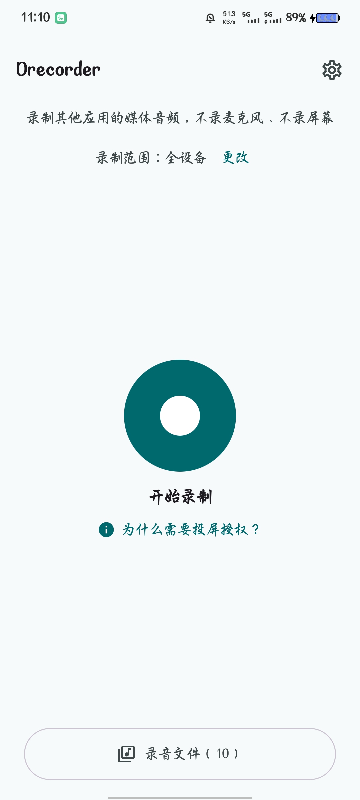
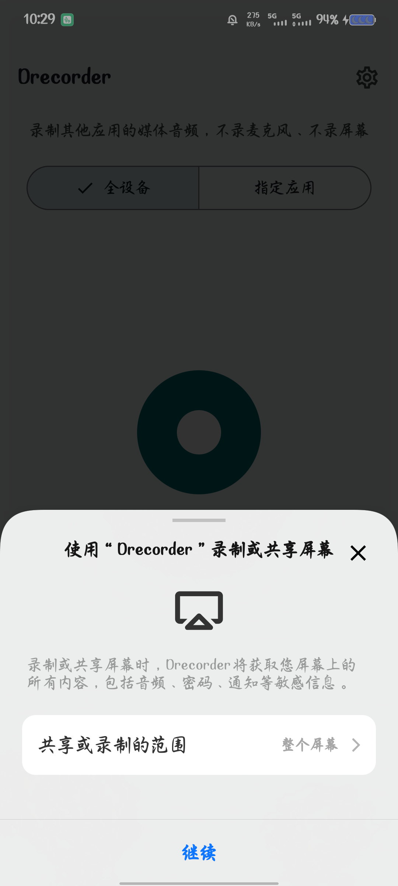
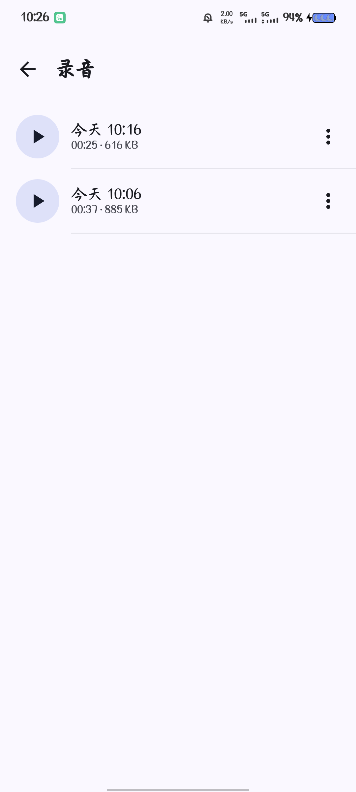
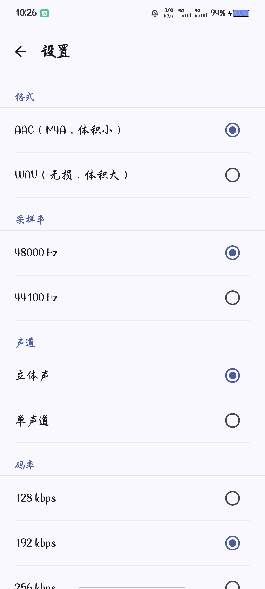

# Drecorder

只录**其他应用正在播放的媒体音频**的 Android App：不录音麦克风、不录屏幕画面、不上传任何内容。

它用的是 Android 10 起官方唯一的合法路径：`MediaProjection` 令牌 + `AudioPlaybackCaptureConfiguration` + `AudioRecord`，编码成 AAC-LC 写进 `.m4a`。为了拿到令牌，系统会弹一次「录制或投射」授权框——**这是因为 Android 至今没有「只授权音频」的授权流程**，不是因为我们要录屏。本 App 从不调用 `createVirtualDisplay()`。

## 能做什么

- 录制全设备媒体音频，或按 UID 只录选中的 App（多选）
- 录音列表：播放（Media3）、重命名、分享、删除
- 静音检测：被录 App 禁止捕获时 8 秒内提示，而不是产出一个 30 分钟的空文件
- 后台悬浮窗：切到别的 App 后顶部显示录制时长 + 「停止」，可拖动、记住位置（需授予「显示在其他应用上层」；不给也能录，只是要回 App 才能停）
- 分段：默认每 30 分钟切一个文件，长录不会因为一段损坏全丢
- 设置：44.1/48 kHz、单/立体声、AAC 128/192/256/320 kbps 或 WAV、保存位置、分段时长
- 自更新：静态 `docs/update.json` + sha256 + 签名证书校验（未签名构建会拒绝发布，见下）

## 界面

首页是「录制台」：先选来源（全设备 / 指定应用），再按唯一的大按钮开始；最近录制以横向卡片出现。

| 首页 | 投屏授权 | 录音列表 | 设置 |
| --- | --- | --- | --- |
|  |  |  |  |

录制中可以切到别的 App，顶部会有可拖动的「时长 + 停止」：


授权弹窗会明确写「共享或录制的范围 → 整个屏幕」——这是 Android 14+ 的默认行为，但默认值原本停在「单个应用」，本 App 显式请求整屏（`MediaProjectionConfig.createConfigForDefaultDisplay()`），否则用户每次都要多点两下。

## 系统要求

- Android 10（API 29）及以上。低于 10 没有回放捕获，唯一替代是 root。
- 被录 App 必须允许被捕获（`android:allowAudioPlaybackCapture`）。Spotify、Chrome、SoundCloud 主动禁止，任何工具都录不到，本 App 只做静音告警。

## 已知限制

- 每次开始录制都要在系统授权框里点一次「允许」。
- Android 15 QPR1+ 名义上「锁屏即终止投屏会话」→ 录制立即收尾。录制页会保持屏幕常亮并提前提示；没有集成 Shizuku，因此不提供「锁屏继续录」。
  - **2026-10-18 实测**：vivo V2196A（Android 15 / API 35）锁屏约 15 秒后录音仍在继续（`AudioRecord` 会话无中断）。是否断流依机型与是否有 QPR1 而定，别把这个结果当成所有 Android 15 的结论。
- 按 UID 过滤只覆盖应用主进程；独立进程（WebView 沙箱、分屏多实例）可能漏音，此时请改用「全设备媒体音频」。
- 录音存放在 App 专属外部目录（默认 `Android/data/dev.drecorder/files/Music/`），卸载 App 会一起删除；需要长期保留请改到用户目录或及时分享出去。

## 构建

工具链（已验证组合，勿随意改）：

| 项 | 值 |
| --- | --- |
| Gradle | 9.6.1 |
| JDK | 25（`D:\Android\Android Studio Preview\jbr`） |
| AGP | 9.4.0（内置 Kotlin，**不要**再 apply `org.jetbrains.kotlin.android`） |
| Compose 编译器插件 | `org.jetbrains.kotlin.plugin.compose` 2.2.10 |
| compileSdk / buildTools / minSdk / targetSdk | 37 / 36.1.0 / 29 / 36 |

```powershell
$env:JAVA_HOME='D:\Android\Android Studio Preview\jbr'
$env:GRADLE_USER_HOME='D:\.gradle'
$env:ANDROID_HOME='D:\Android\Sdk'
& 'D:\.gradle\wrapper\dists\gradle-9.6.1-bin\acdzlsu8y4usa2hnpoh1egy6f\gradle-9.6.1\bin\gradle.bat' `
  -p . :core-audio:testDebugUnitTest :core-data:testDebugUnitTest :app:assembleDebug --console=plain
```

产物 `app/build/outputs/apk/debug/app-debug.apk`。安装：

```powershell
adb install -r app/build/outputs/apk/debug/app-debug.apk
adb shell pm grant dev.drecorder android.permission.RECORD_AUDIO
adb shell pm grant dev.drecorder android.permission.POST_NOTIFICATIONS
```

## 验证一次录音是否真的有声音

```powershell
adb shell ls -l /sdcard/Android/data/dev.drecorder/files/Music
adb pull /sdcard/Android/data/dev.drecorder/files/Music/<文件> out.m4a
python tools/inspect_m4a.py out.m4a
```

`inspect_m4a.py` 打印时长、编码、采样率、声道数、`mdat` 大小与音轨数——时长要和实际录制时间一致，`mdat` 为 0 就说明没拿到数据。是否有声音最终以播放为准。

## 目录结构

```
app/          Compose UI + 前台服务（CaptureService）
core-audio/   采集引擎（ProjectionCaptureEngine、SegmentingWriter、AacM4aWriter/WavWriter、SilenceDetector）
core-data/    录音库（扫目录 + 静音旁车标记）、已安装应用、更新清单解析
docs/         DESIGN.md（设计与平台事实）、aegis/plans（实施计划）、update.json（自更新清单）
scripts/      release.ps1（发布五步）
tools/        inspect_m4a.py、make_icons.py
```

## 发布与自更新（Publishing and self-update）

自更新要求「同签名才能覆盖安装」：`keystore.properties` + `release.jks` 均不入库（见 `.gitignore`），**必须异地备份**，丢失意味着所有用户只能卸载重装、录音数据丢失。

`scripts/release.ps1` 固定五步：构建 → 算 sha256 → 读签名证书 → 重写 `docs/update.json` → 建 GitHub Release。当前仓库**尚未配置 release 签名**，脚本会在第 1 步明确报错而不是产出一个装不上的包。

## 许可

GPL-3.0，见 [LICENSE](LICENSE)。项目引用的同类实现（OpenRecorder、RecordYou、RootlessJamesDSP 等）同为 GPL-3.0；UI 范式参考 Apache-2.0 的 nowinandroid。
